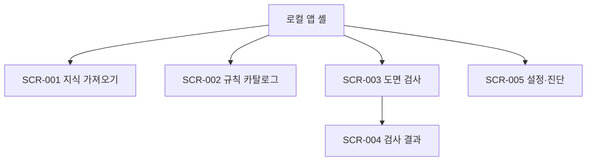

# 정보구조·API 명세서(IA)

| 항목 | 값 |
| --- | --- |
| 문서 ID | DOC-IA-001 |
| 버전 | 0.1.0 |
| 상태 | Draft for Review |
| 기준일 | 2026-10-20 |
| 소유자 | Product Owner |
| 검토자 | Technical Lead, QA Lead |

## 1. 구조 원칙

- 앱 셸은 다섯 작업 영역을 항상 같은 순서로 제공한다.
- URL은 새로고침 가능한 화면 상태를 표현하되 원본 경로나 민감 텍스트를 포함하지 않는다.
- 선택한 프로젝트가 화면 범위의 기준이며 파괴적 행위는 프로젝트 ID와 삭제 대상을 재확인한다.
- 규칙·검색·AI 결과는 시각적으로 섞지 않고 출처 유형을 표시한다.

## 2. 사이트맵

텍스트 대체: 앱 셸의 1차 탐색 항목은 지식 가져오기, 규칙 카탈로그, 도면 검사, 설정·진단이며 도면 검사에서 생성된 분석을 선택하면 검사 결과로 이동한다.

## 3. 화면 레지스트리

| ID | 경로 | 화면 | 관련 기능 | 밀도·주요 역할 |
| --- | --- | --- | --- | --- |
| SCR-001 | `/knowledge/imports` | 지식 가져오기 | FN-001 | 표 중심 고밀도, 파일·매핑 검증 |
| SCR-002 | `/rules` | 규칙 카탈로그 | FN-002 | 필터 가능한 표와 상세 패널 |
| SCR-003 | `/analyses/new` | 도면 검사 | FN-003, FN-004, FN-005, FN-007 | 업로드·품질·작업 진행 |
| SCR-004 | `/analyses/:analysisId` | 검사 결과 | FN-005, FN-006, FN-007, FN-008, FN-009 | 도면 뷰어와 근거 패널 |
| SCR-005 | `/settings` | 설정·진단 | FN-009, FN-010 | 모델·보안·백업·진단 |

## 4. 탐색과 URL 상태

- 좌측 1차 탐색은 다섯 화면 중 현재 위치를 `aria-current="page"`로 표시한다.
- 표의 검색·상태·심각도 필터는 query string에 저장한다.
- 모달, API 키, 원본 파일 경로, 전송 payload는 URL에 넣지 않는다.
- 없는 analysisId는 결과 없음 상태와 도면 검사로 돌아가기 링크를 제공한다.
- 뒤로 가기는 사용자가 확정하지 않은 입력을 조용히 버리지 않고 이탈 확인을 표시한다.

## 5. 도메인 엔터티

| ID | 엔터티 | 핵심 속성 | 민감도 | 보존·삭제 |
| --- | --- | --- | --- | --- |
| ENT-001 | ReviewProject | id, name, created_at, data_version | 내부 | 사용자 삭제까지; 연쇄 삭제 루트 |
| ENT-002 | ImportProfile | sheet rules, column map, image context | 내부 | 지식과 함께 백업 가능 |
| ENT-003 | KnowledgeCase | text, table, image refs, source cell | 기밀 가능 | 프로젝트 삭제까지 |
| ENT-004 | RuleDefinition | state, field, operator, value, unit, severity, source | 내부 | 변경 이력 보존 |
| ENT-005 | DrawingArtifact | hash, type, source ref, parser version | 기밀 | 프로젝트 삭제까지 |
| ENT-006 | DrawingRegion | page/sheet, pixel_bbox, cad_bbox, handles, text | 기밀 | 도면과 함께 삭제 |
| ENT-007 | AnalysisJob | state, steps, timing, config versions | 내부 | 프로젝트 삭제까지 |
| ENT-008 | Finding | status, severity, confidence, type, location | 내부 | 결과와 함께 보존 |
| ENT-009 | Evidence | rule/case/source refs, scores | 내부 | Finding과 함께 보존 |
| ENT-010 | ImprovementSuggestion | problem, location, change, evidence, conditions | 내부 | Finding과 함께 보존 |
| ENT-011 | ModelManifest | artifact, revision, hash, license, requirements | 공개/내부 | 앱 버전과 함께 보존 |
| ENT-012 | ConsentRecord | analysis id, payload digest, timestamp, provider | 보안 | 분석 이력과 함께 보존; payload 미보존 |

## 6. API 카탈로그

| ID | Method·Path | 목적 | 관련 기능·요구사항 |
| --- | --- | --- | --- |
| API-001 | `POST /api/knowledge/imports/preview` | Excel 미리보기 생성 | FN-001, FR-001 |
| API-002 | `POST /api/knowledge/imports/{id}/commit` | 수정 매핑으로 지식 확정 | FN-001, FR-002 |
| API-003 | `GET/POST /api/rules` | 규칙 조회·수동 초안 생성 | FN-002, FR-003 |
| API-004 | `POST /api/rules/{id}/transitions` | 승인·비활성 상태 전이 | FN-002, FR-003 |
| API-005 | `POST /api/drawings/validate` | 파일 품질·지원 여부 검사 | FN-003, FR-004 |
| API-006 | `POST /api/analyses` | 분석 작업 생성 | FN-007, FR-010 |
| API-007 | `GET /api/analyses/{id}` | 단계·진행·버전 조회 | FN-007, FR-010 |
| API-008 | `POST /api/analyses/{id}/cancel` | 작업 취소 | FN-007, FR-010 |
| API-009 | `POST /api/analyses/{id}/retry` | 실패 단계 재시도 | FN-007, FR-010 |
| API-010 | `GET /api/analyses/{id}/findings` | 결과·근거 조회 | FN-006, FN-008, FR-008, FR-009, FR-011 |
| API-011 | `POST /api/analyses/{id}/suggestions/remote` | 동의 기반 OpenAI 보완 | FN-008, FR-012 |
| API-012 | `GET /api/analyses/{id}/export.xlsx|csv` | 결과 내보내기 | FN-009, FR-013 |
| API-013 | `POST /api/backups` | 암호화 백업 생성 | FN-009, FR-014 |
| API-014 | `POST /api/restores/preview|commit` | 복원 검증·확정 | FN-009, FR-014 |
| API-015 | `GET/PUT /api/settings` | 하드웨어·모델·OpenAI 설정 | FN-010, FR-015 |
| API-016 | `DELETE /api/projects/{id}` / `POST /api/diagnostics` | 완전 삭제·진단 생성 | FN-010, FR-016 |

## 7. 백그라운드 처리

| ID | 처리 | 입력 | 출력 | 실패 처리 |
| --- | --- | --- | --- | --- |
| BG-001 | PDF/DXF 정형 추출 | StoredFile | DrawingDocument | 품질 차단 또는 단계 재시도 |
| BG-002 | 승인 규칙 평가 | DrawingDocument, approved rules | Finding | 규칙별 오류 격리, 단위 불명은 정보 부족 |
| BG-003 | 텍스트·Pixel 검색 | region text/tile | Evidence Top-5 | 모델 채널 실패 시 다른 결과 유지 |
| BG-004 | 개선 제안 | Finding, Evidence | ImprovementSuggestion | schema 실패 시 확인 질문 |
| BG-005 | 인덱스 갱신 | KnowledgeCase, versions | FTS/Qdrant points | 변경분 재시도 |

## 8. API 공통 규칙

- 모든 응답은 `request_id`를 포함하며 오류는 RFC 9457 Problem Details 형태를 사용한다.
- 파일 업로드는 스트리밍 처리하고 검증 전에 영구 경로로 이동하지 않는다.
- 상태 변경 요청은 `idempotency_key`와 `expected_version`을 받는다.
- 시간은 UTC ISO 8601로 저장하고 UI에서 로컬 시간으로 표시한다.
- bbox는 `[x_min, y_min, x_max, y_max]`; 픽셀 원점은 좌상단, CAD 원점은 원본 좌표계를 보존한다.
- API 키와 백업 암호는 응답·로그·DB에 평문으로 남기지 않는다.

## 9. 애플리케이션 상태

- 서버 상태는 URL/서버 데이터와 TanStack Query가 관리한다.
- 일시적 UI 상태는 컴포넌트 내부 또는 Zustand의 짧은 세션 상태로 제한한다.
- 업로드·분석 진행은 polling으로 시작하고 안정화 후 SSE를 검토한다. MVP 계약은 polling이다.
- 앱 재시작 후 UI는 API-007에서 영속 작업 상태를 다시 읽는다.

## 10. 변경 이력

| 버전 | 날짜 | 변경 | 작성자 |
| --- | --- | --- | --- |
| 0.1.0 | 2026-10-20 | 최초 정보구조·API 명세 작성 | Product Owner/Agent |
