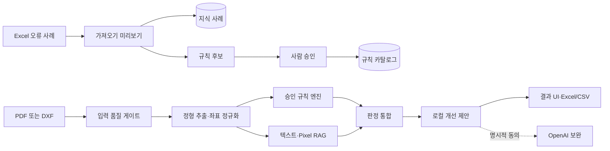

# 개발 도면 사전 검토 및 개선 제안 웹앱 구현 계획

> **For agentic workers:** REQUIRED SUB-SKILL: Use `superpowers:subagent-driven-development` (recommended) or `superpowers:executing-plans` to implement this plan task-by-task. Steps use checkbox (`- [ ]`) syntax for tracking.

**Goal:** Windows 설계자 PC에서 Excel 오류 지식을 구축하고 PDF/DXF 도면의 규칙 위반과 유사 오류를 3분 이내에 찾아 근거가 있는 개선안을 제시하는 로컬 웹앱을 만든다.

**Architecture:** 단일 프로세스 FastAPI 애플리케이션이 React 정적 UI, SQLite 메타데이터, Qdrant 로컬 벡터 인덱스, 파일 저장소와 영속 작업 큐를 관리한다. 입력 어댑터(PDF/DXF/Excel), 결정론적 규칙 엔진, 검색기, 모델 공급자를 포트 뒤에 분리하고 `규칙 검사 → 검색 → 제안` 순서로 실행한다. 로컬 모델이 기본이며 OpenAI 보완 모드는 사용자 동의가 있을 때만 동작한다.

**Tech Stack:** Python 3.12, FastAPI, Pydantic 2, SQLAlchemy 2/Alembic, SQLite, qdrant-client local mode, openpyxl/lxml, PyMuPDF, ezdxf, ONNX Runtime, llama.cpp, React 19, TypeScript 5, Vite, TanStack Query, Zustand, Vitest, Playwright, pytest, Ruff, mypy, PyInstaller, Inno Setup, GitHub Actions Windows runner.

**Spec:** 이 문서의 [확정 설계 기준](#확정-설계-기준) 섹션. 2026-10-20 `grill-me`/`grilling` 세션에서 사용자 승인 완료.

## Global Constraints

- 지원 운영체제는 Windows 10/11 x64이며 Docker를 요구하지 않는다.
- 개발 도구 기준은 Python 3.12.x, Node.js 22 LTS, pnpm 10.x이며 잠금 파일로 정확한 의존성을 재현한다.
- UI와 제안은 한국어가 기본이고 도면의 영문 태그·부품번호는 원문을 보존한다.
- MVP 입력은 암호화되지 않은 `.xlsx`, `.pdf`, `.dxf`로 제한한다. `.xls`, `.dwg`, 암호화 파일은 사유와 함께 거부한다.
- 원본·파생물·벡터·분석 결과는 기본적으로 사용자 PC 안에만 보관한다.
- 외부 텔레메트리를 전송하지 않으며 API 서버는 `127.0.0.1`에만 바인딩한다.
- OpenAI 보완 모드는 기본 비활성이고, 전송 자료 미리보기와 건별 동의를 거쳐야 한다.
- 승인된 규칙만 `위반`을 생성한다. 검색·AI만 근거인 결과는 `의심`, 입력 품질 부족은 `정보 부족`이다.
- AI는 결정론적 규칙 결과를 뒤집거나 자동으로 도면을 수정할 수 없다.
- 일반 도면 1건의 전체 분석 목표는 3분 이내이며 규칙 결과를 먼저 노출한다.
- 입력 상한은 XLSX 100MB, PDF 200MB·100페이지, DXF 100MB다. 성능 기준 도면은 PDF 20페이지 이하 또는 DXF 50MB 이하로 정의한다.
- 품질 게이트는 추출 성공률 95% 이상, 규칙 정밀도 90% 이상, 주요 오류 재현율 80% 이상, Top-5 사례 적중률 80% 이상이다.
- 심각도(`high|medium|low`)와 신뢰도(`0.0..1.0`)는 별도 필드다.
- 모든 결과에 파일 해시, 파서·규칙·모델·프롬프트·인덱스 버전과 원본 좌표를 기록한다.
- 한 PC에서 분석 작업은 한 번에 하나만 실행하며 취소·재시작·실패 단계 재시도를 지원한다.
- 앱 데이터 루트는 `%LOCALAPPDATA%\DevPreReview`, 로컬 주소는 `http://127.0.0.1:17841`로 고정한다.
- 새 동작은 테스트를 먼저 작성하고, 각 작업은 독립적으로 검증 가능한 커밋으로 끝낸다.

## Review Focus

1. **단위가 없거나 서로 다른 치수:** 자동 위반으로 확정하지 않고 `정보 부족`으로 반환한다. Task 8의 `test_unknown_or_mixed_units_are_insufficient`가 고정한다.
2. **회전·병합 셀에 고정된 Excel 이미지:** 실제 앵커 셀과 주변 텍스트를 잃지 않는다. Task 3의 `test_extracts_images_from_merged_and_offset_anchors`가 고정한다.
3. **누락된 DXF XREF·폰트:** 분석을 계속해 오판하지 않고 명시적인 입력 품질 오류로 중단한다. Task 7의 `test_missing_xref_or_font_blocks_rule_evaluation`이 고정한다.
4. **앱 종료 중인 분석 작업:** 재시작 시 마지막 완료 단계부터 이어진다. Task 2의 `test_interrupted_job_resumes_from_last_completed_step`이 고정한다.
5. **OpenAI 동의 철회 또는 전송 실패:** 로컬 결과는 유지하고 외부 전송물은 남기지 않는다. Task 11의 `test_remote_failure_preserves_local_findings`가 고정한다.

---

## 확정 설계 기준

### 사용자와 범위

- 주 사용자는 기계·설비 및 전기·계장 도면을 자체 점검하는 설계자다.
- 계정, 팀 협업, 중앙 서버, 승인 결재, 감시 폴더와 장기 통계는 MVP에서 제외한다.
- DWG 직접 지원, 3D CAD, 자동 도면 수정, PDF 보고서와 수정 전후 비교도 제외한다.

### 지식과 규칙

- 초기 지식은 부분 표준화된 Excel 10개 이하, 오류 사례 1천 건 이하를 전제로 한다.
- 가져오기 미리보기에서 열·시트·이미지 연결을 사람이 확인하고, 확인된 매핑은 프로파일로 저장한다.
- 오류 설명에서 추출한 규칙 후보는 `draft → approved → inactive` 상태를 가진다.
- 규칙은 적용 도면 유형, 검사 필드, 연산자, 기준값, 단위, 예외, 심각도, 출처 사례와 변경 이력을 보존한다.

### 판정과 출력

- 판정 상태는 `violation`, `suspected`, `insufficient_information`이다.
- 각 결과는 문제, 확인 위치, 수정 방법, 규칙·사례 근거, 추가 확인 조건을 포함한다.
- 웹 화면은 도면 위치 하이라이트, 오류 목록, 근거와 개선안을 제공한다.
- Excel/CSV에는 상태, 심각도, 유형, 페이지/엔티티, 좌표, 규칙, 사례, 제안, 신뢰도, 검토 메모를 포함한다.

### 보안과 운영

- OpenAI 키는 Windows 자격 증명 관리자에 저장하고 로그·진단 번들에 원문이나 키를 기록하지 않는다.
- 모델과 예상 디스크 사용량을 다운로드 전에 표시한다.
- 지식·규칙·가져오기 프로파일은 암호화 백업 패키지로 이동할 수 있으며 원본 Excel 포함 여부를 사용자가 선택한다.
- 로컬 진단 번들은 버전, 오류 코드, 단계별 시간만 포함한다.

## 데이터 흐름



## 목표 저장소 구조

```text
apps/
  api/src/dev_pre_review/
    api/                 # FastAPI 라우터와 오류 매핑
    domain/              # 순수 도메인 타입과 판정 불변식
    storage/             # SQLite, Qdrant, 파일 저장소, 마이그레이션
    knowledge/           # Excel 미리보기·가져오기·프로파일
    rules/               # 규칙 후보, 승인, 버전, 실행
    drawings/            # 공통 도면 포트, PDF/DXF 어댑터
    retrieval/           # 텍스트·Pixel 인덱싱과 검색
    models/              # OCR·임베딩·생성·OpenAI 공급자
    analysis/            # 영속 작업 큐와 파이프라인
    export/              # Excel/CSV, 백업, 진단 번들
  web/src/
    app/                 # 라우팅, 공통 셸, API 클라이언트
    features/knowledge/  # 지식 가져오기 화면
    features/rules/      # 규칙 카탈로그 화면
    features/analysis/   # 업로드·진행·결과 화면
    features/settings/   # 모델·OpenAI·진단 화면
packages/contracts/      # OpenAPI에서 생성한 TypeScript 계약
tests/
  fixtures/              # 합성/비식별 테스트 파일
  golden/                # 저장소에는 manifest만, 원본은 외부 관리
packaging/windows/       # PyInstaller·Inno Setup·모델 manifest
.github/workflows/       # Windows CI와 릴리스 빌드
```

## 단계별 구현 계획

### Task 1: 실행 골격과 품질 도구

**Files:**
- Create: `pyproject.toml`, `uv.lock`, `pnpm-workspace.yaml`, `package.json`
- Create: `apps/api/src/dev_pre_review/main.py`, `apps/api/tests/test_health.py`
- Create: `apps/web/package.json`, `apps/web/src/main.tsx`, `apps/web/src/app/App.tsx`
- Create: `apps/web/src/app/App.test.tsx`, `apps/web/vite.config.ts`
- Create: `.editorconfig`, `.gitignore`, `.github/workflows/ci.yml`

**Interfaces:**
- Produces: `create_app() -> FastAPI`, `GET /api/health -> {status, version}` 및 React 앱 셸.

- [ ] **Step 1: 실패하는 백엔드·프론트엔드 스모크 테스트 작성**

```python
def test_health_returns_version(client):
    response = client.get("/api/health")
    assert response.status_code == 200
    assert response.json()["status"] == "ok"
```

```ts
expect(screen.getByRole("heading", { name: "개발 도면 사전 검토" })).toBeVisible();
```

- [ ] **Step 2: `uv run pytest`와 `pnpm test --run`이 모듈 부재로 실패하는지 확인**
- [ ] **Step 3: 최소 FastAPI/React 골격과 Ruff·mypy·ESLint·TypeScript 설정 구현**
- [ ] **Step 4: `uv run pytest && uv run ruff check . && uv run mypy apps/api/src && pnpm test --run && pnpm typecheck` 통과 확인**
- [ ] **Step 5: `chore: scaffold local review application` 커밋**

**Gate:** Windows CI에서 백엔드와 UI 스모크 테스트가 통과해야 Task 2로 진행한다.

### Task 2: 도메인 계약, 영속 상태와 단일 작업 큐

**Files:**
- Create: `apps/api/src/dev_pre_review/domain/models.py`, `domain/enums.py`, `domain/errors.py`
- Create: `apps/api/src/dev_pre_review/storage/database.py`, `storage/schema.py`, `storage/repositories.py`
- Create: `apps/api/src/dev_pre_review/analysis/jobs.py`, `analysis/worker.py`
- Create: `apps/api/alembic.ini`, `apps/api/migrations/versions/0001_initial.py`
- Test: `apps/api/tests/domain/test_models.py`, `apps/api/tests/analysis/test_worker.py`

**Interfaces:**
- Produces: `ReviewProject`, `Finding`, `Evidence`, `KnowledgeCase`, `RuleDefinition`, `DrawingArtifact`, `AnalysisJob` Pydantic 모델.
- Produces: `JobRunner.enqueue(job_id: UUID)`, `cancel(job_id: UUID)`, `resume_pending()`, 동시 실행 수 1.
- Produces: `ProjectDeletionService.delete(project_id: UUID)`; SQLite 행, Qdrant point, 원본·타일·결과 파일을 하나의 삭제 작업으로 정리한다.

- [ ] **Step 1: 상태 전이, 중단 복구, 프로젝트 연쇄 삭제 테스트 작성**

```python
def test_interrupted_job_resumes_from_last_completed_step(job_runner, persisted_job):
    persisted_job.completed_steps = ["validate", "extract"]
    resumed = job_runner.resume(persisted_job.id)
    assert resumed.next_step == "rules"
```

- [ ] **Step 2: `pytest apps/api/tests/domain apps/api/tests/analysis -v`가 타입·저장소 부재로 실패하는지 확인**
- [ ] **Step 3: 도메인 불변식, SQLAlchemy 스키마, Alembic 초기 마이그레이션 구현**
- [ ] **Step 4: 영속 작업 큐와 단계별 체크포인트·취소·재시도 구현**
- [ ] **Step 5: DB·벡터·파일을 멱등하게 정리하고 실패 시 재개되는 프로젝트 삭제 구현**
- [ ] **Step 6: 관련 테스트와 `alembic upgrade head` 통과 확인**
- [ ] **Step 7: `feat: add persistent analysis job model` 커밋**

### Task 3: 안전한 파일 저장소와 Excel 가져오기 미리보기

**Files:**
- Create: `apps/api/src/dev_pre_review/storage/files.py`
- Create: `apps/api/src/dev_pre_review/knowledge/excel_reader.py`, `knowledge/profiles.py`, `knowledge/contracts.py`
- Create: `apps/api/src/dev_pre_review/api/knowledge.py`
- Test: `apps/api/tests/knowledge/test_excel_reader.py`, `test_import_preview_api.py`
- Fixtures: `tests/fixtures/excel/standard.xlsx`, `merged-anchor.xlsx`, `invalid-encrypted.xlsx`

**Interfaces:**
- Produces: `ExcelReader.preview(path: Path) -> ImportPreview`.
- Produces: `ImportProfileRepository.save(profile)` 및 `POST /api/knowledge/imports/preview`.
- Consumes: Task 2의 `KnowledgeCase`와 저장소 트랜잭션.

- [ ] **Step 1: 열 매핑, 병합 셀 이미지 앵커, 암호화 파일 거부 테스트 작성**

```python
def test_extracts_images_from_merged_and_offset_anchors(reader, fixture_path):
    preview = reader.preview(fixture_path("merged-anchor.xlsx"))
    assert preview.images[0].anchor_cell == "D7"
    assert "용접" in preview.images[0].context_text
```

- [ ] **Step 2: 대상 테스트가 `ExcelReader` 부재로 실패하는지 확인**
- [ ] **Step 3: openpyxl과 OOXML drawing relationship를 결합한 읽기 전용 미리보기 구현**
- [ ] **Step 4: 파일명 대신 SHA-256 기반 저장 경로와 원자적 쓰기 구현**
- [ ] **Step 5: API 계약·fixture 테스트 통과 확인**
- [ ] **Step 6: `feat: preview excel knowledge imports` 커밋**

### Task 4: 지식 확정 가져오기와 규칙 후보 카탈로그

**Files:**
- Create: `apps/api/src/dev_pre_review/knowledge/importer.py`
- Create: `apps/api/src/dev_pre_review/rules/candidates.py`, `rules/catalog.py`, `rules/contracts.py`
- Modify: `apps/api/src/dev_pre_review/api/knowledge.py`
- Create: `apps/api/src/dev_pre_review/api/rules.py`
- Test: `apps/api/tests/knowledge/test_importer.py`, `apps/api/tests/rules/test_catalog.py`

**Interfaces:**
- Produces: `KnowledgeImporter.commit(preview_id, corrections) -> ImportResult`.
- Produces: `RuleCandidateExtractor.extract(case: KnowledgeCase) -> list[RuleCandidate]`.
- Produces: `RuleCatalog.transition(rule_id, target_state, expected_version)`.
- Task 4의 기본 추출기는 수치·단위·재질·규격·레이어 패턴만 결정적으로 초안화하고, 해석이 필요한 설명은 수동 입력 대상으로 남긴다. Task 11의 로컬 생성 공급자는 추가 후보를 만들 수 있지만 자동 승인하지 않는다.

- [ ] **Step 1: 수정된 매핑만 확정되고 규칙 상태가 `draft → approved → inactive`로만 전이되는 테스트 작성**
- [ ] **Step 2: 대상 테스트가 구현 부재로 실패하는지 확인**
- [ ] **Step 3: idempotency key를 가진 지식 확정 가져오기와 프로파일 재사용 구현**
- [ ] **Step 4: 결정적 패턴 추출기와 수동 초안 경로, 규칙 필드·단위·예외·출처·심각도·낙관적 버전 잠금을 구현**
- [ ] **Step 5: 재가져오기 중복 방지와 규칙 변경 이력 테스트 통과 확인**
- [ ] **Step 6: `feat: add governed rule catalog` 커밋**

**Gate:** 대표 Excel 3종에서 텍스트·표·이미지 추출 성공률이 95% 미만이면 도면 분석 구현 전에 파서를 보완한다.

### Task 5: 공통 도면 포트와 입력 품질 게이트

**Files:**
- Create: `apps/api/src/dev_pre_review/drawings/ports.py`, `drawings/contracts.py`, `drawings/validation.py`
- Create: `apps/api/src/dev_pre_review/api/drawings.py`
- Test: `apps/api/tests/drawings/test_validation.py`, `test_upload_api.py`

**Interfaces:**
- Produces: `DrawingParser.parse(source: StoredFile) -> DrawingDocument` 프로토콜.
- Produces: `DrawingValidator.validate(file) -> ValidationReport`.
- `DrawingDocument`는 page/sheet, pixel bbox, CAD bbox, 원문 텍스트, 단위, 추출 신뢰도를 공통 표현한다.

- [ ] **Step 1: 확장자·MIME 불일치, 암호화 PDF, DWG/XLS 거부 테스트 작성**
- [ ] **Step 2: 대상 테스트 실패 확인**
- [ ] **Step 3: XLSX 100MB, PDF 200MB·100페이지, DXF 100MB 상한의 스트리밍 업로드, 파일 시그니처 검사와 검증 오류 코드 구현**
- [ ] **Step 4: 공통 좌표·단위 계약 및 parser registry 구현**
- [ ] **Step 5: `pytest apps/api/tests/drawings/test_validation.py -v` 통과 확인**
- [ ] **Step 6: `feat: validate drawing inputs` 커밋**

### Task 6: PDF 추출·OCR·타일링

**Files:**
- Create: `apps/api/src/dev_pre_review/drawings/pdf_parser.py`, `drawings/tiling.py`
- Create: `apps/api/src/dev_pre_review/models/ocr.py`, `models/registry.py`
- Test: `apps/api/tests/drawings/test_pdf_parser.py`, `test_tiling.py`
- Fixtures: `tests/fixtures/pdf/vector.pdf`, `scan-300dpi.pdf`, `scan-lowres.pdf`

**Interfaces:**
- Produces: `PdfParser.parse(source) -> DrawingDocument`.
- Produces: `TileGenerator.create(page, size=1024, overlap=0.25) -> list[DrawingTile]`.
- Produces: `OcrProvider.recognize(image) -> list[TextRegion]`.

- [ ] **Step 1: 벡터 텍스트 좌표, 스캔 OCR, 저해상도 `정보 부족`, 타일 역좌표 테스트 작성**
- [ ] **Step 2: 대상 테스트 실패 확인**
- [ ] **Step 3: PyMuPDF 기반 벡터 추출과 300 DPI 렌더링 구현**
- [ ] **Step 4: OCR 어댑터와 1024px·25% 겹침 타일 생성 구현**
- [ ] **Step 5: PDF fixture와 좌표 round-trip 테스트 통과 확인**
- [ ] **Step 6: `feat: parse and tile pdf drawings` 커밋**

### Task 7: DXF 구조 추출·렌더링·품질 게이트

**Files:**
- Create: `apps/api/src/dev_pre_review/drawings/dxf_parser.py`, `drawings/dxf_render.py`
- Test: `apps/api/tests/drawings/test_dxf_parser.py`, `test_dxf_quality.py`
- Fixtures: `tests/fixtures/dxf/mechanical.dxf`, `electrical.dxf`, `missing-xref.dxf`

**Interfaces:**
- Produces: `DxfParser.parse(source) -> DrawingDocument`.
- 각 영역은 `layer`, `entity_type`, `entity_handle`, `cad_bbox`, `pixel_bbox`, `transform_matrix`를 보존한다.

- [ ] **Step 1: LINE/LWPOLYLINE/TEXT/MTEXT/DIMENSION/INSERT 추출과 XREF·폰트 누락 차단 테스트 작성**

```python
def test_missing_xref_or_font_blocks_rule_evaluation(parser, fixture_path):
    document = parser.parse(fixture_path("missing-xref.dxf"))
    assert document.quality.blocking_issues == ["missing_xref"]
```

- [ ] **Step 2: 대상 테스트 실패 확인**
- [ ] **Step 3: ezdxf 정상 읽기와 recover 모드, modelspace/paperspace 분리 구현**
- [ ] **Step 4: 레이어 렌더링과 CAD↔픽셀 변환 행렬 구현**
- [ ] **Step 5: 엔티티 핸들·좌표 round-trip 및 품질 게이트 테스트 통과 확인**
- [ ] **Step 6: `feat: parse and render dxf drawings` 커밋**

### Task 8: 결정론적 규칙 엔진

**Files:**
- Create: `apps/api/src/dev_pre_review/rules/engine.py`, `rules/operators.py`, `rules/units.py`
- Test: `apps/api/tests/rules/test_engine.py`, `test_units.py`

**Interfaces:**
- Produces: `RuleEngine.evaluate(document, approved_rules) -> list[Finding]`.
- 연산자는 `required`, `equals`, `matches`, `min`, `max`, `range`, `allowed_values`만 MVP에서 지원한다.
- 단위 정규화는 mm/cm/m/inch를 지원하고 불명확한 단위는 `insufficient_information`으로 반환한다.

- [ ] **Step 1: 치수·공차, 재질·규격·부품번호, 레이어·선종·축척·양식 규칙 테스트 작성**

```python
def test_unknown_or_mixed_units_are_insufficient(engine, document, rule):
    finding = engine.evaluate(document.with_units(None), [rule])[0]
    assert finding.status == "insufficient_information"
```

- [ ] **Step 2: 테스트 실패 확인**
- [ ] **Step 3: 타입별 연산자와 단위 변환을 순수 함수로 구현**
- [ ] **Step 4: 승인 상태 필터, 예외 적용, 좌표·근거 생성 구현**
- [ ] **Step 5: `pytest apps/api/tests/rules -v`와 mypy 통과 확인**
- [ ] **Step 6: `feat: evaluate approved drawing rules` 커밋**

**Gate:** 골든셋에서 규칙 정밀도 90%, 주요 오류 재현율 80% 미만이면 RAG가 이를 가리도록 진행하지 않고 규칙·추출기를 보완한다.

### Task 9: 텍스트 지식 인덱스와 하이브리드 검색

**Files:**
- Create: `apps/api/src/dev_pre_review/retrieval/vector_store.py`, `retrieval/text_index.py`, `retrieval/hybrid.py`
- Create: `apps/api/src/dev_pre_review/models/embeddings.py`
- Test: `apps/api/tests/retrieval/test_text_index.py`, `test_hybrid.py`

**Interfaces:**
- Produces: `EmbeddingProvider.embed_texts(texts) -> NDArray[float32]`.
- Produces: `TextIndex.upsert(cases, index_version)`와 `HybridRetriever.search(query, filters, top_k=5)`.
- Qdrant payload는 사례 ID, 분야, 오류 유형, 심각도, 출처 셀, 모델·인덱스 버전을 포함한다.
- 키워드 검색은 SQLite FTS5/BM25, 벡터 검색은 Qdrant local mode, 결합은 RRF를 사용한다. 이 Task에서 프로젝트 삭제 시 Qdrant point와 FTS row를 정리하는 삭제 어댑터를 Task 2 서비스에 등록한다.

- [ ] **Step 1: idempotent upsert, 분야 필터, 한국어 키워드+벡터 결합 순위 테스트 작성**
- [ ] **Step 2: 대상 테스트 실패 확인**
- [ ] **Step 3: SQLite FTS5, Qdrant 로컬 컬렉션, 임베딩 공급자 포트와 프로젝트 삭제 어댑터 구현**
- [ ] **Step 4: RRF 기반 키워드·벡터 결합 및 변경분 재색인 구현**
- [ ] **Step 5: 합성 검색 fixture로 결정적 Top-5 테스트 통과 확인**
- [ ] **Step 6: `feat: add hybrid knowledge retrieval` 커밋**

### Task 10: Pixel RAG와 하드웨어 프로파일

**Files:**
- Create: `apps/api/src/dev_pre_review/retrieval/visual_index.py`, `retrieval/pixel_rag.py`
- Create: `apps/api/src/dev_pre_review/models/hardware.py`, `models/manifests.py`
- Create: `packaging/windows/models.json`
- Test: `apps/api/tests/retrieval/test_pixel_rag.py`, `apps/api/tests/models/test_hardware.py`

**Interfaces:**
- Produces: `VisualEmbeddingProvider.embed_images(images) -> NDArray[float32]`.
- Produces: `PixelRetriever.search(tile, top_k=5) -> list[VisualEvidence]`.
- Produces: `HardwareDetector.detect() -> HardwareProfile`과 `ModelRegistry.recommend(profile)`.
- CPU 기본 manifest는 PaddleOCR 한국어 mobile OCR, `intfloat/multilingual-e5-small` ONNX 텍스트 임베딩, `openai/clip-vit-base-patch32` ONNX 시각 임베딩, 선택 다운로드형 `Qwen3-4B-Instruct` GGUF Q4_K_M 생성 모델을 사용한다.
- GPU 프로파일은 같은 계약의 CUDA 실행 공급자로 교체하며 모델별 URL, revision, SHA-256, 크기와 라이선스를 `models.json`에 고정한다.

- [ ] **Step 1: CPU fallback, GPU 감지, 모델 미설치 시 규칙 전용 실행, 타일 좌표 근거 테스트 작성**
- [ ] **Step 2: 대상 테스트 실패 확인**
- [ ] **Step 3: CPU 기본 manifest의 OCR·텍스트·시각 임베딩과 CUDA 가속 공급자 선택 구현**
- [ ] **Step 4: 모델 manifest의 URL·SHA-256·크기·라이선스·최소 사양 검증 구현**
- [ ] **Step 5: Excel 사례 이미지를 색인하고 도면 타일로 조회하며 텍스트·시각 점수를 별도 보존하는 Pixel RAG 검색 구현**
- [ ] **Step 6: fixture 기준 Top-5 평가 명령 `uv run python -m dev_pre_review.evaluation retrieval` 통과 확인**
- [ ] **Step 7: `feat: add hardware-aware pixel retrieval` 커밋**

**Gate:** 골든셋 Top-5 적중률이 80% 미만이면 모델·타일 크기·필터를 평가 보고서로 비교한 뒤 기본 프로파일을 확정한다.

### Task 11: 분석 오케스트레이션과 근거 기반 개선 제안

**Files:**
- Create: `apps/api/src/dev_pre_review/analysis/pipeline.py`, `analysis/fusion.py`
- Create: `apps/api/src/dev_pre_review/models/generation.py`, `models/openai_provider.py`, `models/consent.py`
- Test: `apps/api/tests/analysis/test_pipeline.py`, `test_fusion.py`, `test_remote_provider.py`

**Interfaces:**
- Produces: `AnalysisPipeline.run(job_id) -> AnalysisResult` 단계 `validate/extract/rules/retrieve/suggest/export_ready`.
- Produces: `FindingFusion.merge(rule_findings, retrieved_evidence) -> list[Finding]`.
- Produces: `SuggestionProvider.suggest(finding, evidence) -> ImprovementSuggestion`.

- [ ] **Step 1: 규칙 우선, AI 비격상, 근거 없는 제안 금지, OpenAI 실패 격리 테스트 작성**

```python
def test_remote_failure_preserves_local_findings(pipeline, failing_remote):
    result = pipeline.run_with_remote(failing_remote)
    assert result.local_findings
    assert result.remote_status == "failed_without_data_retention"
```

- [ ] **Step 2: 대상 테스트 실패 확인**
- [ ] **Step 3: 단계별 체크포인트와 규칙 결과 조기 공개 파이프라인 구현**
- [ ] **Step 4: `위반/의심/정보 부족` 융합 불변식과 근거 순위 구현**
- [ ] **Step 5: llama.cpp와 Qwen3-4B-Instruct GGUF를 사용한 문제·위치·수정·근거·확인 조건 JSON schema 기반 로컬 제안 구현**
- [ ] **Step 6: 로컬 생성 공급자가 해석형 규칙 후보를 `draft`로만 추가하는 경로 구현**
- [ ] **Step 7: Windows Credential Manager, OpenAI Responses API, 전송 미리보기, 건별 동의, 메모리 내 전송물 폐기 구현**
- [ ] **Step 8: 파이프라인·복구·동의 철회 테스트 통과 확인**
- [ ] **Step 9: `feat: orchestrate evidence-backed analysis` 커밋**

### Task 12: API 계약과 핵심 React 화면

**Files:**
- Create: `apps/api/src/dev_pre_review/api/analyses.py`, `api/settings.py`, `api/errors.py`
- Create: `apps/web/src/features/knowledge/*`, `features/rules/*`, `features/analysis/*`, `features/settings/*`
- Create: `apps/web/src/app/router.tsx`, `apps/web/src/app/api.ts`
- Generate: `packages/contracts/src/generated.ts`
- Test: `apps/api/tests/api/test_analyses.py`, `apps/web/src/features/**/*.test.tsx`

**Interfaces:**
- Produces: OpenAPI 계약 및 생성된 TypeScript 타입.
- Endpoints: `POST /api/analyses`, `GET /api/analyses/{id}`, `POST /cancel`, `POST /retry`, `GET /findings`.
- Screens: 지식 가져오기, 규칙 카탈로그, 도면 검사, 검사 결과, 설정·진단.

- [ ] **Step 1: OpenAPI 응답과 다섯 화면의 핵심 사용자 동작 테스트 작성**
- [ ] **Step 2: API와 UI 테스트 실패 확인**
- [ ] **Step 3: 도메인 오류→한국어 문제 응답 매핑과 OpenAPI 타입 생성 구현**
- [ ] **Step 4: 가져오기 미리보기·규칙 승인·프로젝트 삭제·업로드·진행률 UI 구현**
- [ ] **Step 5: PDF/DXF 렌더 이미지 위 좌표 하이라이트와 근거 패널 구현**
- [ ] **Step 6: 키보드 접근성, 색 외 상태 표현, 1280×720 최소 레이아웃 테스트**
- [ ] **Step 7: `pnpm test --run && pnpm typecheck`와 API 계약 테스트 통과 확인**
- [ ] **Step 8: `feat: add local review workflow UI` 커밋**

### Task 13: Excel/CSV 내보내기, 백업·복원과 진단

**Files:**
- Create: `apps/api/src/dev_pre_review/export/findings.py`, `export/backup.py`, `export/diagnostics.py`
- Create: `apps/api/src/dev_pre_review/api/export.py`
- Test: `apps/api/tests/export/test_findings.py`, `test_backup.py`, `test_diagnostics.py`

**Interfaces:**
- Produces: `FindingExporter.to_xlsx(result_id)`, `to_csv(result_id)`.
- Produces: `BackupService.create(passphrase, include_sources)`와 `restore(package, passphrase)`.
- Produces: `DiagnosticBundle.create()`, 원문·키·절대 경로 제외.

- [ ] **Step 1: 내보내기 열·한국어 인코딩·암호화 백업 round-trip·비밀정보 제거 테스트 작성**
- [ ] **Step 2: 대상 테스트 실패 확인**
- [ ] **Step 3: 고정 열 순서의 XLSX/UTF-8 BOM CSV 구현**
- [ ] **Step 4: Argon2id 키 유도와 AES-256-GCM 인증 암호화, 버전 manifest를 가진 백업·복원 구현**
- [ ] **Step 5: 버전·오류 코드·성능만 담는 진단 번들 구현**
- [ ] **Step 6: export 전체 테스트 통과 확인**
- [ ] **Step 7: `feat: export and protect review data` 커밋**

### Task 14: 골든셋 평가와 성능 예산

**Files:**
- Create: `apps/api/src/dev_pre_review/evaluation/metrics.py`, `evaluation/runner.py`, `evaluation/report.py`
- Create: `tests/golden/manifest.schema.json`, `tests/golden/README.md`
- Create: `scripts/run_golden_evaluation.ps1`
- Test: `apps/api/tests/evaluation/test_metrics.py`, `test_runner.py`

**Interfaces:**
- Produces: `EvaluationRunner.run(manifest) -> EvaluationReport`.
- 지표: 추출 성공률, precision, recall, Top-5 hit rate, p50/p95 단계별 시간.

- [ ] **Step 1: 고정 혼동행렬과 검색 순위에 대한 지표 계산 테스트 작성**
- [ ] **Step 2: 대상 테스트 실패 확인**
- [ ] **Step 3: 튜닝/최종 평가 분리와 파일 해시 검증을 가진 manifest 구현**
- [ ] **Step 4: JSON·Markdown 평가 보고서와 임계값 기반 종료 코드 구현**
- [ ] **Step 5: 비식별 fixture 평가가 결정적으로 통과하는지 확인**
- [ ] **Step 6: 8코어 CPU·RAM 16GB·GPU 없음 기준 PC에서 실제 골든셋의 네 가지 품질 기준과 PDF 20페이지/DXF 50MB 이하 도면의 3분 성능 기준 확인**
- [ ] **Step 7: `test: add golden-set quality gates` 커밋**

### Task 15: Windows 패키징, 설치·업데이트 검증과 출시 게이트

**Files:**
- Create: `packaging/windows/dev-pre-review.spec`, `packaging/windows/installer.iss`
- Create: `apps/api/src/dev_pre_review/launcher.py`, `storage/paths.py`
- Create: `.github/workflows/windows-release.yml`
- Create: `docs/install-windows.md`, `docs/privacy-and-local-data.md`, `docs/model-licenses.md`
- Test: `apps/api/tests/test_launcher.py`, `tests/e2e/review-flow.spec.ts`

**Interfaces:**
- Produces: 서명 가능한 `DevPreReview-Setup-x64.exe`.
- 런처는 `127.0.0.1:17841`의 단일 인스턴스를 보장하며, 동일 앱의 health token이 확인되면 기존 창을 열고 다른 프로세스가 점유했으면 안전하게 종료한다.

- [ ] **Step 1: localhost 바인딩·단일 인스턴스·데이터 경로·업그레이드 보존 테스트 작성**
- [ ] **Step 2: 런처 테스트 실패 확인**
- [ ] **Step 3: PyInstaller sidecar, React 정적 자산, Alembic 자동 마이그레이션 구현**
- [ ] **Step 4: Inno Setup 설치·제거와 사용자 데이터 보존 정책 구현**
- [ ] **Step 5: Windows CI에서 깨끗한 VM 설치 후 Excel→규칙 승인→PDF/DXF 검사→CSV 내보내기 E2E 실행**
- [ ] **Step 6: 종속성·모델 라이선스, 오프라인 실행, 방화벽 비노출 검증**
- [ ] **Step 7: 전체 테스트와 골든셋 게이트 통과 후 설치 파일 해시 생성**
- [ ] **Step 8: `build: package windows review application` 커밋**

## 단계별 출시 기준

| 단계 | 완료 범위 | 사용자에게 제공되는 가치 | Go/No-Go 기준 |
| --- | --- | --- | --- |
| M0 | Task 1–2 | 실행 가능한 로컬 골격과 복구 가능한 작업 | Windows CI·마이그레이션 통과 |
| M1 | Task 3–4 | Excel 지식·승인 규칙 카탈로그 | 추출 성공률 ≥95% |
| M2 | Task 5–8 | PDF/DXF 결정론적 사전 검사 | 정밀도 ≥90%, 재현율 ≥80% |
| M3 | Task 9–10 | 텍스트·Pixel RAG 근거 | Top-5 적중률 ≥80% |
| M4 | Task 11–13 | 개선 제안·완성된 로컬 UX·내보내기 | 근거 없는 제안 0건, 외부 전송 기본 0건 |
| MVP | Task 14–15 | 검증·설치 가능한 Windows 제품 | 전체 분석 ≤3분, 모든 품질 게이트 통과 |

## 테스트 데이터 운영

- 실제 회사 도면은 Git 저장소에 커밋하지 않는다.
- `tests/fixtures`에는 합성 또는 비식별 최소 재현 파일만 둔다.
- 실제 골든셋은 앱 외부의 암호화 저장소에서 관리하고 `tests/golden/manifest`에는 해시·정답 ID·분할만 기록한다.
- 최종 평가 분할은 모델·프롬프트·규칙 튜닝에 사용하지 않는다.
- 오류 사례 100건 이상, PDF 10건, DXF 10건, 전문가 표기 오류 50건 이상이 확보되기 전 품질 수치를 출시 근거로 사용하지 않는다.

## 위험과 대응

| 위험 | 조기 신호 | 대응 |
| --- | --- | --- |
| Excel 이미지와 셀 의미의 잘못된 연결 | 미리보기 수정률 증가 | 앵커+주변 셀 프로파일, 확정 전 사용자 검증 |
| DXF 렌더링과 CAD 좌표 불일치 | 하이라이트 round-trip 오차 | 변환 행렬 저장, fixture 좌표 테스트, 오류 시 규칙 결과만 표시 |
| 저사양 PC에서 3분 초과 | 단계별 p95 예산 초과 | 규칙 우선 표시, 타일 수 제한, 모델 등급 조정, 작업 1개 제한 |
| Pixel RAG 유사도가 오류 의미와 불일치 | Top-5 적중률 하락 | 분야·도면 유형 필터, OCR+시각 하이브리드, 골든셋 재평가 |
| AI 개선안 환각 | 근거 ID 없는 제안 | JSON schema와 근거 필수, 없으면 확인 질문만 출력 |
| 모델 라이선스·용량 문제 | 설치 패키지 비대화 | 모델 별도 다운로드, manifest에 라이선스·크기·해시 표시 |
| OpenAI 데이터 유출 | 동의 없는 네트워크 요청 | provider 기본 미등록, 미리보기·건별 동의·네트워크 통합 테스트 |

## MVP 완료 정의

- [ ] Windows 10/11 x64의 새 사용자 계정에서 설치·실행·제거가 가능하다.
- [ ] 앱은 네트워크 없이 Excel 지식 등록과 PDF/DXF 규칙 검사를 완료한다.
- [ ] 5개 핵심 화면이 한국어로 동작하고 키보드만으로 주요 흐름을 완료할 수 있다.
- [ ] 모든 판정이 원본 셀·페이지·타일 또는 DXF 엔티티 좌표로 추적된다.
- [ ] 규칙·검색·AI의 역할과 판정 상태가 UI와 내보내기에서 구분된다.
- [ ] 중단 작업 복구, 데이터 삭제, 암호화 백업·복원이 검증된다.
- [ ] 외부 전송은 기본 0건이며 OpenAI 보완 모드에서만 명시적 동의 후 발생한다.
- [ ] 네 가지 품질 기준과 3분 성능 기준을 독립 최종 평가 분할에서 충족한다.
- [ ] 전체 테스트, 타입 검사, lint, Windows E2E, 설치 패키지 검증이 CI에서 통과한다.

## 실행 원칙

1. Task 순서를 유지하되 각 Gate를 통과하기 전 다음 지능 계층으로 넘어가지 않는다.
2. 한 Task의 구현과 테스트가 끝나면 diff를 검토하고 해당 Task만 커밋한다.
3. 파서·규칙 엔진·좌표 변환은 실제 사례에서 발견한 실패를 최소 fixture로 환원해 회귀 테스트로 남긴다.
4. 모델이나 프롬프트 변경은 골든셋 보고서와 모델 manifest 변경을 같은 커밋에 포함한다.
5. MVP 제외 범위 요청은 별도 이슈로 기록하고 이 계획의 Task에 끼워 넣지 않는다.
